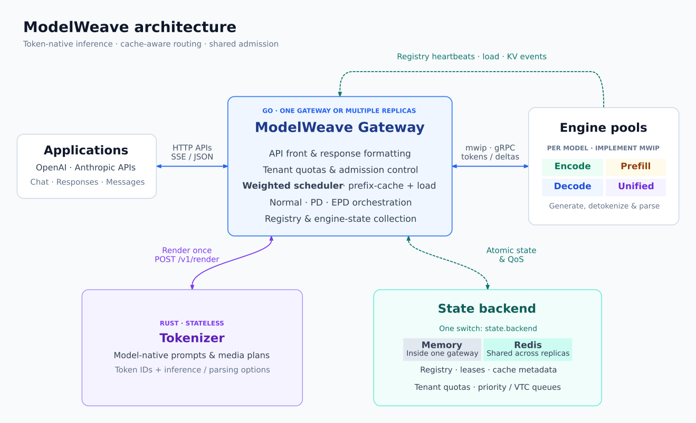

# ModelWeave

[English](README.md) · [简体中文](README.zh.md)

**A cache- and load-aware gateway for LLM inference.**

Applications use OpenAI or Anthropic APIs. ModelWeave renders model-native
token IDs, schedules engine instances through **mwip** (gRPC), and returns
their parsed output as SSE or JSON.

## Features

- **Multi-model, multimodal.** DeepSeek V4 / V4.1, Qwen3, Qwen3-VL and Hugging
  Face chat templates; content-derived media positions support prefix caching.
- **Pluggable routing.** Weighted `prefix-cache` and `load` scorers, configurable
  per model and role; custom scorers and selection policies register as plugins.
- **Normal, PD and EPD.** Run on one instance, separate prefill/decode, or encode
  media first—with retries, deadlines and fallback.
- **Standalone or distributed.** One `state.backend` switch selects memory or
  Redis for registry/state, reservations, caches, tenant RPM/TPM/concurrency
  limits and per-model priority/fair-admission queues.
- **One engine contract.** Engines receive tokens and generation options, then
  detokenize and parse their own output. No gateway-side engine API adapters.
- **Observable and testable.** Prometheus, structured access logs and GPU-free
  mock engines for integration tests.
- **Built-in admin console.** Models, instances, load/queues and tenant quotas;
  drain/resume and persistent-by-ID instance isolation through a token-protected API.

## Architecture



| Component | Responsibility |
|---|---|
| **Gateway · Go** | Authentication, admission, scheduling, orchestration and response formatting |
| **Tokenizer · Rust** | Stateless prompt rendering, tokenization and media planning |
| **Engine instances** | One model and role each: encode, prefill, decode or unified |

Solid lines show requests/output; dashed lines show control/state updates.
[Architecture details](docs/architecture.md) · [Diagram source and exports](assets/diagrams/README.md)

## Quick start

Requires Docker and Compose v2. The local stack uses mock engines; no GPU is needed.

```sh
make images
make up
make e2e

curl -s localhost:38080/v1/chat/completions \
  -H 'Authorization: Bearer sk-team-a' \
  -H 'Content-Type: application/json' \
  -d '{"model":"deepseek-v4.1","messages":[{"role":"user","content":"Hello"}]}'
```

Gateway: `:38080` · Registry: `:38082` · Tokenizer: `:38090`.
For models, tenants, ports and more requests, see the [local stack guide](deploy/compose/README.md).

Open **http://localhost:38080/admin/** for the embedded management console
(local stack token: `local-control-token`). No frontend build or separate web
server is needed. See [admin operations and security](docs/admin.md).

## Deployment mode

The default is `state.backend: memory` for one gateway. For replicas, use a
shared Redis namespace; tenant quotas and admission queues are global too:

```yaml
state:
  backend: redis
  redis:
    url: "${MW_REDIS_URL}"
    namespace: modelweave-v3
```

[Full configuration](configs/gateway.example.yaml) · [Redis example](configs/gateway.redis.example.yaml) ·
[Consistency, migration and scheduling plugins](docs/state-and-scheduling.md)

## Integrate an engine

1. Implement the [mwip Engine service](proto/modelweave/mwip/v1): `Generate`,
   plus `Encode`, `Abort` and `GetState` as needed.
2. Register one model/role through the gateway's Registry and keep heartbeating.

See the [protocol guide](docs/mwip.md) and [minimal Python engine](examples/python-engine).
Engines built on vLLM, SGLang or another runtime must expose this mwip service.

## Development

Requires Go 1.26+, Rust 1.88+ and Node 20+ for console tests (not for builds/runtime).

```sh
make build      # gateway, tokenizer and mock engine
make test       # Go race tests + Rust tests + dependency-free console tests
make lint       # gofmt, rustfmt and clippy
make diagrams   # regenerate SVG/PNG; requires Python 3 and Graphviz
```

## Documentation

- [Architecture](docs/architecture.md) — request lifecycle, execution modes and code map
- [State and scheduling](docs/state-and-scheduling.md) — memory/Redis, QoS, plugins and weights
- [Admin console and API](docs/admin.md) — inventory, instance isolation, security and browser tests
- [mwip](docs/mwip.md) · [Multimodal contract](docs/multimodal.md) · [Wire protocols](docs/protocol.md) · [Observability](docs/observability.md)
- [Tokenizer/model configuration](configs/tokenizer.example.toml) · [Local stack](deploy/compose/README.md)

## Acknowledgements and license

Inspired by [deepseek-recipe](https://github.com/deepseek-ai/deepseek-recipe),
[SGLang](https://github.com/sgl-project/sglang), [vLLM](https://github.com/vllm-project/vllm),
[llm-d](https://github.com/llm-d/llm-d) and [Mooncake](https://github.com/kvcache-ai/Mooncake).
Model processing follows [transformers](https://github.com/huggingface/transformers) and
[qwen-vl-utils](https://github.com/QwenLM/Qwen3-VL).

[Apache-2.0](LICENSE). Bundled tokenizer files retain their own licenses:
DeepSeek V4.1 is MIT; Qwen3 and Qwen3-VL are Apache-2.0. See [assets/tokenizers](assets/tokenizers).
