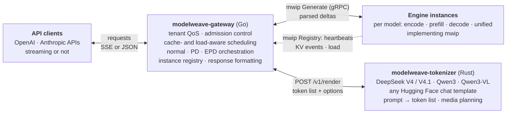
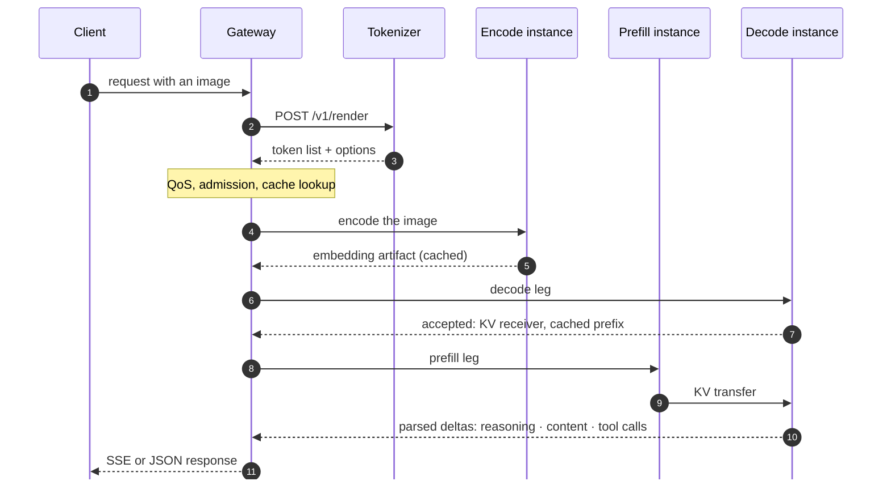

# ModelWeave

**An open-source gateway and scheduler for LLM serving.**

ModelWeave sits between applications and a fleet of inference engines.
Applications speak the OpenAI or Anthropic API. ModelWeave turns every
request into one engine-neutral token list and picks the engine instances
that should run it: it reuses their prefix cache, balances their load, and
splits prefill, decode and media encoding across instances when that pays
off. It drives the engines through **mwip**, its own gRPC engine protocol,
and streams the answer back in the application's API.

It is two services with a strict division of labour. A stateless Rust
**tokenizer** knows models: their prompt formats, special tokens and vision
processors. A Go **gateway** knows the fleet: tenants, instances, caches and
load. Engines generate and parse their own output.

## Highlights

- **Many models, one tokenizer.** DeepSeek V4 / V4.1, Qwen3, Qwen3-VL and any
  model with a Hugging Face chat template are registered side by side from
  their Hugging Face files. Prompts match transformers' `apply_chat_template`
  token for token, and control tokens can only come from the template.
- **One engine protocol: mwip.** Engines implement a gRPC service defined in
  [proto/](proto/modelweave/mwip/v1) and receive the intermediate state as
  is: token IDs with media already expanded, the options to sample, and the
  parsers to apply. Engine output comes back already parsed. Every engine
  plugs in this way; there are no adapters for other engine APIs.
- **Many models, instances by role.** Each served model has its own engine
  instances, each in one role: encode, prefill, decode or unified. Instances
  register with the gateway's mwip Registry by heartbeat. The gateway keeps
  them per model and role, expires those whose heartbeats stop, and drains or
  removes them one at a time while the others keep serving.
- **Disaggregated serving.** Each request runs *normal* (one instance), *PD*
  (prefill and decode on different instances, with push, bootstrap or pull KV
  handshakes) or *EPD* (media encoded on encode instances first). The mode is
  decided per request from cache hits and prompt length, with retries and
  fallback.
- **Prefix-cache-aware scheduling.** Images and video frames occupy pad values
  derived from their content, so block hashes cover multimodal prompts too.
  Caches are learned from routing, from engine KV events or from an external
  index; load comes from heartbeats or `GetState` polls.
- **Memory or distributed state.** Use standalone in-process memory, or Redis
  to share registration, instance load/health/drains, atomic capacity
  reservations, prefix indexes, sessions and artifact metadata across gateways.
  Tenant limits and per-model admission queues use the same backend switch:
  quotas, priorities and weighted fair queueing are global in Redis mode.
  An engine only needs to heartbeat to one replica.
- **Pluggable scheduling.** Registered policy/scorer factories; the default
  weighted composition combines `prefix-cache` and `load` scores with
  independently configurable weights per model and role.
- **Traffic control.** Tenants by API key with priorities, request and token
  rate limits, concurrency caps, a fair admission queue and overload
  shedding.
- **Observable and testable.** Prometheus metrics for every stage, a JSON
  access-log line per request, and a mock engine that runs the whole system
  without GPUs.

## Architecture



- **`modelweave-tokenizer`** (Rust) converts Chat Completions, Responses and
  Messages requests into the *intermediate state*. The conversation is
  rendered by the model's prompt format into one token list, with images and
  videos already expanded to the positions they take, and comes with the
  options engines need to generate and parse. The tokenizer is stateless and
  knows nothing about engines.
- **`modelweave-gateway`** (Go) authenticates and admits requests, chooses
  instances of the requested model and orchestrates the execution mode. It
  sends the intermediate state to the instances and formats their parsed
  output for the client, as SSE or as one JSON body. It serves the mwip
  Registry, where instances register.
- **Engine instances** each serve one model in one role: encode, prefill,
  decode or unified. They implement mwip ([docs/mwip.md](docs/mwip.md)),
  register with heartbeats that carry their load and KV events, and parse
  reasoning and tool calls themselves.
- **`modelweave-mockengine`** simulates an engine instance for local runs and
  tests: the mwip Engine service and the registration lifecycle, prefix
  cache, KV hand-off, encoders, timing and faults.

### A request, step by step



The gateway renders the request once (2–3), admits and plans it, and has the
image encoded (4–5). It then sends the decode and prefill legs, and the
prefill instance pushes the KV the decode instance lacks (6–9). The decode
instance streams parsed deltas, which the gateway formats for the client
(10–11). A short prompt or a prefix-cache hit skips the prefill instance, so
the decode instance runs the request alone; text-only requests skip the
encode stage.

## Supported models

| Family | Models | Prompt format | Reasoning and tool calls | Images and videos |
|---|---|---|---|---|
| `deepseek-v4.1` | DeepSeek V4.1 | deepseek-recipe encoding | thinking switch, DSML tool calls | ✓ |
| `deepseek-v4` | DeepSeek V4 | deepseek-recipe encoding | thinking switch, DSML tool calls | |
| `qwen3` | Qwen3 | the model's chat template | `<think>` with `enable_thinking`, hermes tool calls | |
| `qwen3-vl` | Qwen3-VL | the model's chat template | hermes tool calls | ✓ |
| `chat-template` | any model with a Hugging Face chat template | the model's chat template | configured parsers | |

The bundled DeepSeek V4.1, Qwen3-8B and Qwen3-VL-8B-Instruct tokenizers are
registered in [configs/tokenizer.example.toml](configs/tokenizer.example.toml).
Another model takes a few lines:

```toml
[[models]]
name = "Qwen3-32B"
aliases = ["qwen3-32b"]
family = "qwen3"
path = "/models/Qwen3-32B"     # tokenizer.json, tokenizer_config.json, generation_config.json, ...
context_length = 40960
```

## Quick start

Requirements: Docker with Compose v2. No GPU is needed: mock engines simulate
inference.

```sh
make images   # build the tokenizer, gateway, mock engine and e2e images
make up       # gateways on :38080 and :38081 (mwip Registry on :38082), tokenizer on :38090
make e2e      # 41 end-to-end tests inside the compose network
```

Behind a proxy, export `http_proxy`, `https_proxy` and `no_proxy` before
`make images`.

```sh
# DeepSeek V4.1 and Qwen3 behind the same gateway and tokenizer
curl -s localhost:38080/v1/chat/completions -H 'Authorization: Bearer sk-team-a' \
  -H 'Content-Type: application/json' \
  -d '{"model":"deepseek-v4.1","messages":[{"role":"user","content":"Hello"}]}'

curl -s localhost:38080/v1/messages -H 'x-api-key: sk-team-a' \
  -H 'Content-Type: application/json' \
  -d '{"model":"qwen3","max_tokens":256,"messages":[{"role":"user","content":"Hello"}]}'
```

[deploy/compose/README.md](deploy/compose/README.md) describes the local
stack (its models, instances and tenants) and has more requests to try.

## Plugging in engines

Engines plug in through mwip, and only through it. An engine instance:

1. serves the Engine service of
   [proto/modelweave/mwip/v1](proto/modelweave/mwip/v1): `Generate`, plus
   `Encode`, `Abort` and `GetState` as needed;
2. registers with the gateway's Registry (`server.grpc_listen`, default
   `:8081`) as one model in one role, and keeps heartbeating. An instance
   whose heartbeats stop expires after `discovery.heartbeat_ttl`, and
   `Deregister` removes it at once.

There are no adapters for other engine APIs: an engine built on vLLM,
SGLang or another framework plugs in by serving the Engine service in front
of it. [docs/mwip.md](docs/mwip.md) explains the protocol, and
[examples/python-engine](examples/python-engine) is a minimal Python engine
that runs against the local stack:

```sh
cd examples/python-engine && pip install -r requirements.txt
python -m grpc_tools.protoc -I ../../proto --python_out=gen --grpc_python_out=gen ../../proto/modelweave/mwip/v1/*.proto
MW_CONTROL_TOKEN=local-control-token python engine.py --registry 127.0.0.1:38082 \
  --target $(docker network inspect modelweave_default -f '{{(index .IPAM.Config 0).Gateway}}'):50051 \
  --model external-engine --id py-0
```

## Building from source

Go 1.26+ and Rust 1.88+:

```sh
make build   # bin/modelweave-gateway, bin/modelweave-tokenizer, bin/modelweave-mockengine
make test    # Go tests with the race detector, Rust tests (incl. golden prompts from transformers)
make lint    # gofmt, rustfmt, clippy
make proto   # regenerate api/mwip/v1 from proto/ (protoc, protoc-gen-go, protoc-gen-go-grpc)

bin/modelweave-tokenizer --config configs/tokenizer.example.toml --listen 127.0.0.1:8090
bin/modelweave-gateway -config configs/gateway.example.yaml
```

## Documentation

- [docs/state-and-scheduling.md](docs/state-and-scheduling.md): memory/Redis
  state, consistency and failure behaviour, two replicas, scheduling plugins
  and score weights

- [docs/mwip.md](docs/mwip.md): mwip, the engine protocol: models, roles and
  instances, the Engine and Registry services, the Generate stream, errors,
  the lifecycle of an instance, implementing an engine
- [docs/architecture.md](docs/architecture.md): components, request
  lifecycle, model registry, execution modes, scheduling, QoS, package map
- [docs/protocol.md](docs/protocol.md): the intermediate state, media planning
  per model family, the engine protocol, PD and EPD, control plane
- [docs/observability.md](docs/observability.md): metrics, logs, example
  queries
- [deploy/compose/README.md](deploy/compose/README.md): the local stack
- [examples/python-engine](examples/python-engine): an mwip engine in Python
- [README.zh.md](README.zh.md): 中文说明

## Acknowledgements

ModelWeave's ideas come from deepseek-recipe and the SGLang and vLLM
communities:

- [deepseek-recipe](https://github.com/deepseek-ai/deepseek-recipe):
  converting OpenAI and Anthropic requests into a conversation, the DeepSeek
  V4 / V4.1 prompt encodings, and the shape of the intermediate state, one
  token list with the conversation, inference and parsing options engines
  need. ModelWeave renders DeepSeek prompts with it.
- [SGLang](https://github.com/sgl-project/sglang) and its model gateway:
  cache-aware routing with a load-imbalance guard, PD disaggregation with a
  bootstrap rendezvous, content-derived pad values that let prefix caches
  cover images, encoder disaggregation, and chat templates rendered in Rust.
- [vLLM](https://github.com/vllm-project/vllm): token-in generation with
  engine-side output parsing, KV and EC connectors for PD and EPD, KV-cache
  events, and the handling of chat-template content formats and tool calls.

ModelWeave also follows Hugging Face
[transformers](https://github.com/huggingface/transformers) (chat-template
semantics, Qwen-VL processors) and
[qwen-vl-utils](https://github.com/QwenLM/Qwen3-VL) (video frame sampling),
and borrows from [llm-d](https://github.com/llm-d/llm-d) (scorer
composition) and [Mooncake](https://github.com/kvcache-ai/Mooncake) (KV
transfer).

## License

Apache License 2.0 ([LICENSE](LICENSE)). The bundled tokenizer files keep
their own licenses: DeepSeek V4.1 is MIT licensed, Qwen3 and Qwen3-VL are
Apache-2.0 licensed (see [assets/tokenizers](assets/tokenizers)).
