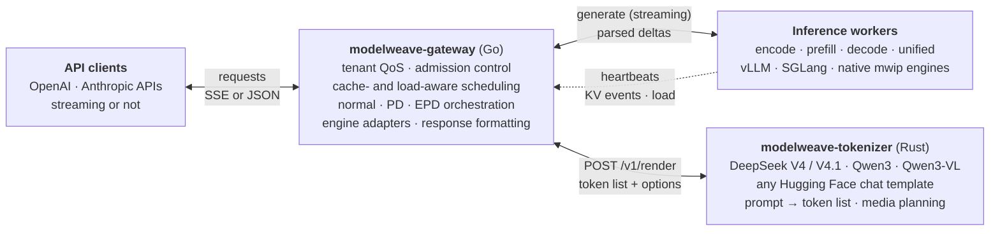

# ModelWeave

**An open-source gateway and scheduler for LLM serving.**

ModelWeave sits between applications and a fleet of inference engines.
Applications speak the OpenAI or Anthropic API. ModelWeave turns every
request into one engine-neutral token list and picks the workers that should
run it: it reuses their prefix cache, balances their load, and splits
prefill, decode and media encoding across workers when that pays off. It
drives the engines over vLLM's, SGLang's or its own protocol, and streams the
answer back in the application's API.

It is two services with a strict division of labour. A stateless Rust
**tokenizer** knows models: their prompt formats, special tokens and vision
processors. A Go **gateway** knows the fleet: tenants, workers, caches and
load. Engines generate and parse their own output.

## Highlights

- **Many models, one tokenizer.** DeepSeek V4 / V4.1, Qwen3, Qwen3-VL and any
  model with a Hugging Face chat template are registered side by side from
  their Hugging Face files. Prompts match transformers' `apply_chat_template`
  token for token, and control tokens can only come from the template.
- **Any engine.** The same gateway drives vLLM (token-in generate, KV and EC
  connectors), SGLang (`/generate`, bootstrap PD) or engines that speak
  ModelWeave's native protocol, mwip. The protocol is a startup option.
- **Disaggregated serving.** Each request runs *normal* (one worker), *PD*
  (prefill and decode on different workers, with push, bootstrap or pull KV
  handshakes) or *EPD* (media encoded on encoder workers first). The mode is
  decided per request from cache hits and prompt length, with retries and
  fallback.
- **Prefix-cache-aware scheduling.** Images and video frames occupy pad values
  derived from their content, so block hashes cover multimodal prompts too.
  Caches are learned from routing, from engine KV events or from an external
  index; load comes from heartbeats or the engines' Prometheus metrics.
- **Traffic control.** Tenants by API key with priorities, request and token
  rate limits, concurrency caps, a fair admission queue and overload
  shedding.
- **Observable and testable.** Prometheus metrics for every stage, a JSON
  access-log line per request, and a mock engine that runs the whole system
  without GPUs.

## Architecture



- **`modelweave-tokenizer`** (Rust) converts Chat Completions, Responses and
  Messages requests into the *intermediate state*. The conversation is
  rendered by the model's prompt format into one token list, with images and
  videos already expanded to the positions they take, and comes with the
  options engines need to generate and parse. The tokenizer is stateless and
  knows nothing about engines.
- **`modelweave-gateway`** (Go) authenticates and admits requests, chooses
  workers and orchestrates the execution mode. It adapts the intermediate
  state to the engine protocol and formats the engines' parsed output for the
  client, as SSE or as one JSON body.
- **Workers** are inference engines in the roles encode, prefill, decode or
  unified. They register with heartbeats (or are configured statically),
  report load and KV events, and parse reasoning and tool calls themselves.
- **`modelweave-mockengine`** simulates workers for all three protocols
  (prefix cache, KV hand-off, encoders, timing and faults) for local runs and
  tests.

### A request, step by step


The gateway renders the request once (2–3), admits and plans it, and has the
image encoded (4–5). It then sends the decode and prefill legs, and the
prefill worker pushes the KV the decode worker lacks (6–9). The decode worker
streams parsed deltas, which the gateway formats for the client (10–11). A
short prompt or a prefix-cache hit skips the prefill worker, so the decode
worker runs the request alone; text-only requests skip the encoder.

## Supported models

| Family | Models | Prompt format | Reasoning and tool calls | Images and videos |
|---|---|---|---|---|
| `deepseek-v4.1` | DeepSeek V4.1 | deepseek-recipe encoding | thinking switch, DSML tool calls | ✓ |
| `deepseek-v4` | DeepSeek V4 | deepseek-recipe encoding | thinking switch, DSML tool calls | |
| `qwen3` | Qwen3 | the model's chat template | `<think>` with `enable_thinking`, hermes tool calls | |
| `qwen3-vl` | Qwen3-VL | the model's chat template | hermes tool calls | ✓ |
| `chat-template` | any model with a Hugging Face chat template | the model's chat template | configured parsers | |

The bundled DeepSeek V4.1, Qwen3-8B and Qwen3-VL-8B-Instruct tokenizers are
registered in [configs/tokenizer.example.toml](configs/tokenizer.example.toml).
Another model takes a few lines:

```toml
[[models]]
name = "Qwen3-32B"
aliases = ["qwen3-32b"]
family = "qwen3"
path = "/models/Qwen3-32B"     # tokenizer.json, tokenizer_config.json, generation_config.json, ...
context_length = 40960
```

## Quick start

Requirements: Docker with Compose v2. No GPU is needed: mock engines simulate
inference.

```sh
make images   # build the tokenizer, gateway, mock engine and e2e images
make up       # gateways on :38080 and :38081, tokenizer on :38090
make e2e      # 44 end-to-end tests inside the compose network
```

Behind a proxy, export `http_proxy`, `https_proxy` and `no_proxy` before
`make images`.

```sh
# DeepSeek V4.1 and Qwen3 behind the same gateway and tokenizer
curl -s localhost:38080/v1/chat/completions -H 'Authorization: Bearer sk-team-a' \
  -H 'Content-Type: application/json' \
  -d '{"model":"deepseek-v4.1","messages":[{"role":"user","content":"Hello"}]}'

curl -s localhost:38080/v1/messages -H 'x-api-key: sk-team-a' \
  -H 'Content-Type: application/json' \
  -d '{"model":"qwen3","max_tokens":256,"messages":[{"role":"user","content":"Hello"}]}'
```

[deploy/compose/README.md](deploy/compose/README.md) describes the local
stack (its models, workers and tenants) and has more requests to try.

## Running with real engines

- Pick the engine protocol at startup with
  `modelweave-gateway -config gateway.yaml -engine-protocol vllm` (or `sglang`,
  `mwip`), or per model with `models[].engine_protocol`.
- **vLLM**: start it with the model's reasoning and tool-call parsers (for
  Qwen3, `--reasoning-parser qwen3 --tool-call-parser hermes`). PD uses the
  MooncakeConnector (`bootstrap`) or the NixlConnector (`pull`); EPD uses an
  EC-producer instance registered as an encode worker.
- **SGLang**: PD uses bootstrap, and media are encoded inside SGLang
  (`--encoder-urls`). Its `/generate` returns raw text, so use vLLM or mwip
  when clients need parsed reasoning and tool calls.
- Workers register with heartbeats (`POST /mwip/v1/heartbeat`) or are listed
  in `discovery.workers`. Their load is read from heartbeats or scraped from
  vLLM and SGLang Prometheus metrics, without engine changes.

[docs/protocol.md](docs/protocol.md) has the fields of every protocol.

## Building from source

Go 1.26+ and Rust 1.88+:

```sh
make build   # bin/modelweave-gateway, bin/modelweave-tokenizer, bin/modelweave-mockengine
make test    # Go tests with the race detector, Rust tests (incl. golden prompts from transformers)
make lint    # gofmt, rustfmt, clippy

bin/modelweave-tokenizer --config configs/tokenizer.example.toml --listen 127.0.0.1:8090
bin/modelweave-gateway -config configs/gateway.example.yaml -engine-protocol vllm
```

## Documentation

- [docs/architecture.md](docs/architecture.md): components, request
  lifecycle, model registry, execution modes, scheduling, QoS, package map
- [docs/protocol.md](docs/protocol.md): the intermediate state, media planning
  per model family, engine protocols, PD and EPD per protocol, control plane
- [docs/observability.md](docs/observability.md): metrics, logs, example
  queries
- [deploy/compose/README.md](deploy/compose/README.md): the local stack
- [README.zh.md](README.zh.md): 中文说明

## Acknowledgements

ModelWeave's ideas come from deepseek-recipe and the SGLang and vLLM
communities:

- [deepseek-recipe](https://github.com/deepseek-ai/deepseek-recipe):
  converting OpenAI and Anthropic requests into a conversation, the DeepSeek
  V4 / V4.1 prompt encodings, and the shape of the intermediate state, one
  token list with the conversation, inference and parsing options engines
  need. ModelWeave renders DeepSeek prompts with it.
- [SGLang](https://github.com/sgl-project/sglang) and its model gateway:
  cache-aware routing with a load-imbalance guard, PD disaggregation with a
  bootstrap rendezvous, content-derived pad values that let prefix caches
  cover images, encoder disaggregation, and chat templates rendered in Rust.
- [vLLM](https://github.com/vllm-project/vllm): token-in generation with
  engine-side output parsing, KV and EC connectors for PD and EPD, KV-cache
  events, and the handling of chat-template content formats and tool calls.

ModelWeave also follows Hugging Face
[transformers](https://github.com/huggingface/transformers) (chat-template
semantics, Qwen-VL processors) and
[qwen-vl-utils](https://github.com/QwenLM/Qwen3-VL) (video frame sampling),
and borrows from [llm-d](https://github.com/llm-d/llm-d) (scorer
composition) and [Mooncake](https://github.com/kvcache-ai/Mooncake) (KV
transfer).

## License

Apache License 2.0 ([LICENSE](LICENSE)). The bundled tokenizer files keep
their own licenses: DeepSeek V4.1 is MIT licensed, Qwen3 and Qwen3-VL are
Apache-2.0 licensed (see [assets/tokenizers](assets/tokenizers)).
