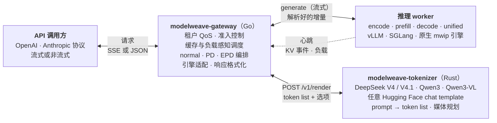
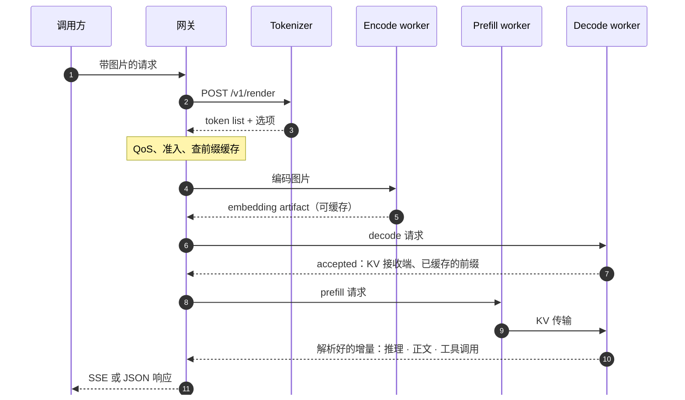

# ModelWeave

**开源的大模型推理网关与调度器。**

ModelWeave 位于应用和一组推理引擎之间。应用使用 OpenAI 或 Anthropic 协议发请求，ModelWeave 把每个请求转换成一份与引擎无关的 token list，再挑选执行它的 worker：尽量复用它们的前缀缓存、均衡负载，并在划算的时候把 prefill、decode 和媒体编码拆到不同的 worker 上。它通过 vLLM、SGLang 或自己的原生协议驱动引擎，最后按应用使用的协议把结果流式返回。

系统由两个服务组成，分工明确。无状态的 Rust **tokenizer** 了解模型：prompt 格式、特殊 token、视觉 processor。Go **网关**了解集群：租户、worker、缓存和负载。引擎负责生成，并解析自己的输出。

## 亮点

- **多个模型，一个 tokenizer。** DeepSeek V4 / V4.1、Qwen3、Qwen3-VL，以及任何带 Hugging Face chat template 的模型，都直接用它们的 Hugging Face 文件注册，在同一个 tokenizer 里并存。渲染出的 prompt 与 transformers 的 `apply_chat_template` 逐 token 一致，控制 token 只能由模板产生。
- **适配多种引擎。** 同一个网关可以驱动 vLLM（token-in generate、KV / EC connector）、SGLang（`/generate`、bootstrap 方式的 PD），也可以驱动使用 ModelWeave 原生协议 mwip 的引擎。协议在启动时选择。
- **分离式执行。** 每个请求以 *normal*（单个 worker）、*PD*（prefill 与 decode 在不同 worker 上，支持 push、bootstrap、pull 三种 KV 握手）或 *EPD*（媒体先在 encode worker 上编码）方式执行。执行方式按请求根据缓存命中和 prompt 长度决定，带重试和回退。
- **前缀缓存感知调度。** 图片和视频帧占用的位置填的是由内容推导出的 pad value，所以 block hash 也能覆盖多模态 prompt。缓存信息来自路由记录、引擎上报的 KV 事件或外部索引；负载来自心跳或引擎的 Prometheus 指标。
- **流量控制。** 按 API key 区分租户，支持优先级、请求数和 token 数限流、并发上限、公平的准入队列以及过载保护。
- **可观测、可测试。** 每个阶段都有 Prometheus 指标，每个请求输出一行 JSON 访问日志；mock 引擎让整个系统不需要 GPU 就能运行。

## 架构



- **`modelweave-tokenizer`**（Rust）把 Chat Completions、Responses 和 Messages 请求转换成*中间态*：按模型的 prompt 格式把对话渲染成一个 token list（图片和视频已经展开成它们占用的位置），并附上引擎生成和解析所需的选项。tokenizer 无状态，也不感知引擎。
- **`modelweave-gateway`**（Go）负责鉴权和准入、选择 worker、编排执行方式。它把中间态适配成引擎协议，再把引擎解析好的输出格式化后返回给客户端，形式是 SSE 或一个 JSON。
- **worker** 是承担 encode、prefill、decode 或 unified 角色的推理引擎。它们通过心跳注册（也可以静态配置），上报负载和 KV 事件，并自己解析推理内容和工具调用。
- **`modelweave-mockengine`** 模拟三种协议的 worker（前缀缓存、KV 交接、encoder、时延和故障），用于本地运行和测试。

### 一个请求的执行过程



网关只渲染一次请求（2–3），完成准入和执行规划后，先把图片交给 encode worker 编码（4–5）。然后发出 decode 和 prefill 两段请求，prefill worker 把 decode worker 缺少的 KV 推过去（6–9）。decode worker 流式返回解析好的增量，网关把它们格式化后返回给客户端（10–11）。prompt 很短或前缀缓存命中时会跳过 prefill worker，由 decode worker 单独执行；纯文本请求则跳过 encoder。

## 支持的模型

| 家族 | 模型 | prompt 格式 | 推理与工具调用 | 图片和视频 |
|---|---|---|---|---|
| `deepseek-v4.1` | DeepSeek V4.1 | deepseek-recipe 编码 | 思考开关、DSML 工具调用 | ✓ |
| `deepseek-v4` | DeepSeek V4 | deepseek-recipe 编码 | 思考开关、DSML 工具调用 | |
| `qwen3` | Qwen3 | 模型自带的 chat template | `<think>`（`enable_thinking`）、hermes 工具调用 | |
| `qwen3-vl` | Qwen3-VL | 模型自带的 chat template | hermes 工具调用 | ✓ |
| `chat-template` | 任何带 Hugging Face chat template 的模型 | 模型自带的 chat template | 按配置指定解析器 | |

内置的 DeepSeek V4.1、Qwen3-8B、Qwen3-VL-8B-Instruct tokenizer 注册在 [configs/tokenizer.example.toml](configs/tokenizer.example.toml) 里。新增一个模型只需要几行：

```toml
[[models]]
name = "Qwen3-32B"
aliases = ["qwen3-32b"]
family = "qwen3"
path = "/models/Qwen3-32B"     # tokenizer.json、tokenizer_config.json、generation_config.json 等
context_length = 40960
```

## 快速开始

依赖：Docker 与 Compose v2。不需要 GPU，推理由 mock 引擎模拟。

```sh
make images   # 构建 tokenizer、网关、mock 引擎和 e2e 镜像
make up       # 网关 :38080 和 :38081，tokenizer :38090
make e2e      # 在 compose 网络内跑 44 个端到端用例
```

在代理环境下，执行 `make images` 前先 export `http_proxy`、`https_proxy` 和 `no_proxy`。

```sh
# DeepSeek V4.1 和 Qwen3 共用同一个网关和 tokenizer
curl -s localhost:38080/v1/chat/completions -H 'Authorization: Bearer sk-team-a' \
  -H 'Content-Type: application/json' \
  -d '{"model":"deepseek-v4.1","messages":[{"role":"user","content":"你好"}]}'

curl -s localhost:38080/v1/messages -H 'x-api-key: sk-team-a' \
  -H 'Content-Type: application/json' \
  -d '{"model":"qwen3","max_tokens":256,"messages":[{"role":"user","content":"你好"}]}'
```

[deploy/compose/README.md](deploy/compose/README.md) 介绍了本地栈（模型、worker、租户），并给出了更多可以尝试的请求。

## 接入真实引擎

- 在启动时选择引擎协议：`modelweave-gateway -config gateway.yaml -engine-protocol vllm`（或 `sglang`、`mwip`），也可以用 `models[].engine_protocol` 按模型指定。
- **vLLM**：启动时开启模型对应的推理和工具调用解析器（Qwen3 用 `--reasoning-parser qwen3 --tool-call-parser hermes`）。PD 使用 MooncakeConnector（`bootstrap`）或 NixlConnector（`pull`）；EPD 使用注册为 encode worker 的 EC producer 实例。
- **SGLang**：PD 使用 bootstrap，媒体在 SGLang 内部编码（`--encoder-urls`）。它的 `/generate` 只返回原始文本，客户端需要解析好的推理内容和工具调用时，请使用 vLLM 或 mwip。
- worker 通过心跳（`POST /mwip/v1/heartbeat`）注册，或写在 `discovery.workers` 里。负载来自心跳，或直接抓取 vLLM、SGLang 的 Prometheus 指标，不需要改动引擎。

各协议的字段见 [docs/protocol.md](docs/protocol.md)。

## 从源码构建

需要 Go 1.26+、Rust 1.88+：

```sh
make build   # bin/modelweave-gateway、bin/modelweave-tokenizer、bin/modelweave-mockengine
make test    # 带 race 检测的 Go 测试、Rust 测试（含与 transformers 对齐的 golden prompt）
make lint    # gofmt、rustfmt、clippy

bin/modelweave-tokenizer --config configs/tokenizer.example.toml --listen 127.0.0.1:8090
bin/modelweave-gateway -config configs/gateway.example.yaml -engine-protocol vllm
```

## 文档

- [docs/architecture.md](docs/architecture.md)：组件、请求生命周期、模型注册表、执行方式、调度、QoS、代码目录
- [docs/protocol.md](docs/protocol.md)：中间态、各模型家族的媒体规划、引擎协议、各协议下的 PD 与 EPD、控制面
- [docs/observability.md](docs/observability.md)：指标、日志、查询示例
- [deploy/compose/README.md](deploy/compose/README.md)：本地栈
- [README.md](README.md)：English

## 致谢

ModelWeave 的思路来自 deepseek-recipe 以及 SGLang、vLLM 社区：

- [deepseek-recipe](https://github.com/deepseek-ai/deepseek-recipe)：把 OpenAI、Anthropic 请求转换成对话，DeepSeek V4 / V4.1 的 prompt 编码，以及中间态的形态，即一个 token list 加上引擎需要的对话、推理和解析选项。ModelWeave 用它渲染 DeepSeek 的 prompt。
- [SGLang](https://github.com/sgl-project/sglang) 及其 model gateway：带负载失衡保护的 cache 感知路由、基于 bootstrap 汇合的 PD 分离、让前缀缓存覆盖图片的内容派生 pad value、encoder 分离，以及用 Rust 渲染 chat template。
- [vLLM](https://github.com/vllm-project/vllm)：token-in 生成与引擎侧输出解析、用于 PD 和 EPD 的 KV / EC connector、KV cache 事件，以及 chat template content 格式和工具调用的处理方式。

此外，ModelWeave 遵循 Hugging Face [transformers](https://github.com/huggingface/transformers)（chat template 语义、Qwen-VL processor）和 [qwen-vl-utils](https://github.com/QwenLM/Qwen3-VL)（视频抽帧）的实现，并借鉴了 [llm-d](https://github.com/llm-d/llm-d)（scorer 组合）和 [Mooncake](https://github.com/kvcache-ai/Mooncake)（KV 传输）。

## 许可证

Apache License 2.0（[LICENSE](LICENSE)）。内置的 tokenizer 文件保留各自的许可证：DeepSeek V4.1 为 MIT，Qwen3 和 Qwen3-VL 为 Apache-2.0（见 [assets/tokenizers](assets/tokenizers)）。
