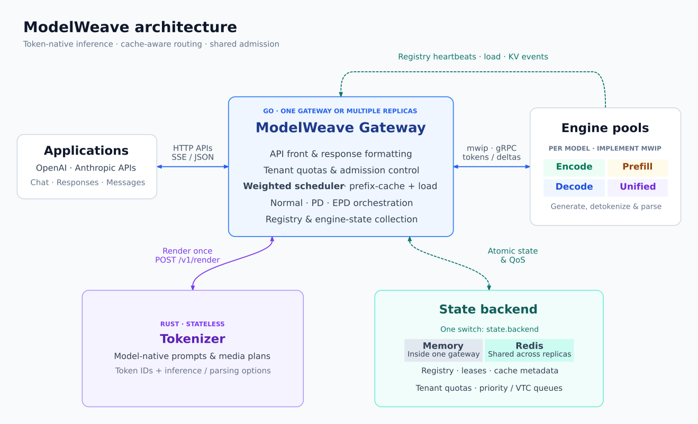

# ModelWeave

[English](README.md) · [简体中文](README.zh.md)

**缓存与负载感知的大模型推理网关。**

应用使用 OpenAI 或 Anthropic API。ModelWeave 将请求渲染为模型原生 token ID，
通过 **mwip**（gRPC）调度引擎实例，再把引擎解析好的输出以 SSE 或 JSON 返回。

## 核心能力

- **多模型、多模态。** 支持 DeepSeek V4 / V4.1、Qwen3、Qwen3-VL 和 Hugging Face chat template；媒体内容参与前缀缓存哈希。
- **插件式调度。** 算法按[插件目录](plugins/scheduling)组织，提供公开 Go SDK 和管理台插件清单；每个模型可组合缓存、负载、亲和、标签偏好等算法并配置权重，各角色可独立覆盖。
- **Normal / PD / EPD。** 单实例执行、prefill/decode 分离，或先编码媒体；支持重试、超时和回退。
- **单机与分布式。** `state.backend` 统一切换内存或 Redis：注册表、实例状态、容量预留、缓存、租户 RPM/TPM/并发额度和按模型的优先级公平队列。
- **统一引擎协议。** 引擎接收 token 和生成选项，自行反分词、解析输出；网关不适配各引擎的原生 API。
- **可观测、可验证。** Prometheus、结构化访问日志，以及无需 GPU 的 mock 引擎与集成测试。
- **内置管理平台。** 查询模型、实例、负载/队列和租户配额，支持摘流/恢复、按实例 ID 拉黑/解除拉黑及令牌保护的管理 API。

## 架构



| 组件 | 职责 |
|---|---|
| **Gateway · Go** | 鉴权、准入、调度、执行编排、响应格式化 |
| **Tokenizer · Rust** | 无状态的 prompt 渲染、分词和媒体规划 |
| **引擎实例** | 每个实例服务一个模型、一个角色：encode、prefill、decode 或 unified |

实线表示请求与输出，虚线表示控制面与状态更新。
[架构详解](docs/architecture.md) · [图源与导出图片](assets/diagrams/README.md)

## 快速开始

需要 Docker 与 Compose v2。本地栈使用 mock 引擎，无需 GPU。

```sh
make images
make up
make e2e

curl -s localhost:38080/v1/chat/completions \
  -H 'Authorization: Bearer sk-team-a' \
  -H 'Content-Type: application/json' \
  -d '{"model":"deepseek-v4.1","messages":[{"role":"user","content":"你好"}]}'
```

网关：`:38080` · Registry：`:38082` · Tokenizer：`:38090`。
模型、租户、端口和更多请求示例见[本地栈说明](deploy/compose/README.md)。

打开 **http://localhost:38080/admin/** 即可使用内嵌管理平台（本地栈令牌：
`local-control-token`），无需构建前端或部署额外的 Web 服务。
参见[管理操作、安全与 API](docs/admin.md)。

## 部署模式

默认 `state.backend: memory`，适用于单个网关。多副本使用同一个 Redis namespace，
租户额度和准入队列也随之全局共享：

```yaml
state:
  backend: redis
  redis:
    url: "${MW_REDIS_URL}"
    namespace: modelweave-v3
```

[完整配置](configs/gateway.example.yaml) · [Redis 示例](configs/gateway.redis.example.yaml) ·
[一致性、迁移与调度插件](docs/state-and-scheduling.md)

## 接入引擎

1. 实现 [mwip Engine 服务](proto/modelweave/mwip/v1)：`Generate`，以及按需实现 `Encode`、`Abort`、`GetState`。
2. 以一个模型、一个角色注册到网关的 Registry，并持续发送心跳。

参见[协议指南](docs/mwip.md)和[最小 Python 引擎](examples/python-engine)。
基于 vLLM、SGLang 等运行时的引擎，也需提供该 mwip 服务。

## 开发

需要 Go 1.26+、Rust 1.88+；管理平台测试另需 Node 20+（构建和运行网关不需要）。

```sh
make build      # 网关、tokenizer、mock 引擎
make test       # Go race 测试 + Rust 测试 + 无依赖的前端逻辑测试
make lint       # gofmt、rustfmt、clippy
make diagrams   # 重新生成 SVG/PNG；需要 Python 3 和 Graphviz
```

## 文档

- [架构](docs/architecture.md)：请求生命周期、执行模式与代码目录
- [状态与调度](docs/state-and-scheduling.md)：内存/Redis、QoS、插件与权重
- [插件目录与 SDK](plugins/scheduling/README.md) · [多模型差异化组合示例](configs/gateway.scheduling.example.yaml)
- [管理平台与 API](docs/admin.md)：资源查询、实例隔离、安全和浏览器测试
- [mwip](docs/mwip.md) · [多模态执行契约](docs/multimodal.md) · [接口协议](docs/protocol.md) · [可观测性](docs/observability.md)
- [Tokenizer/模型配置](configs/tokenizer.example.toml) · [本地栈](deploy/compose/README.md)

## 致谢与许可

借鉴 [deepseek-recipe](https://github.com/deepseek-ai/deepseek-recipe)、
[SGLang](https://github.com/sgl-project/sglang)、[vLLM](https://github.com/vllm-project/vllm)、
[llm-d](https://github.com/llm-d/llm-d) 和 [Mooncake](https://github.com/kvcache-ai/Mooncake)；
模型处理遵循 [transformers](https://github.com/huggingface/transformers) 和
[qwen-vl-utils](https://github.com/QwenLM/Qwen3-VL)。

[Apache-2.0](LICENSE)。内置 tokenizer 文件保留各自许可：DeepSeek V4.1 为 MIT，
Qwen3 / Qwen3-VL 为 Apache-2.0，见 [assets/tokenizers](assets/tokenizers)。
