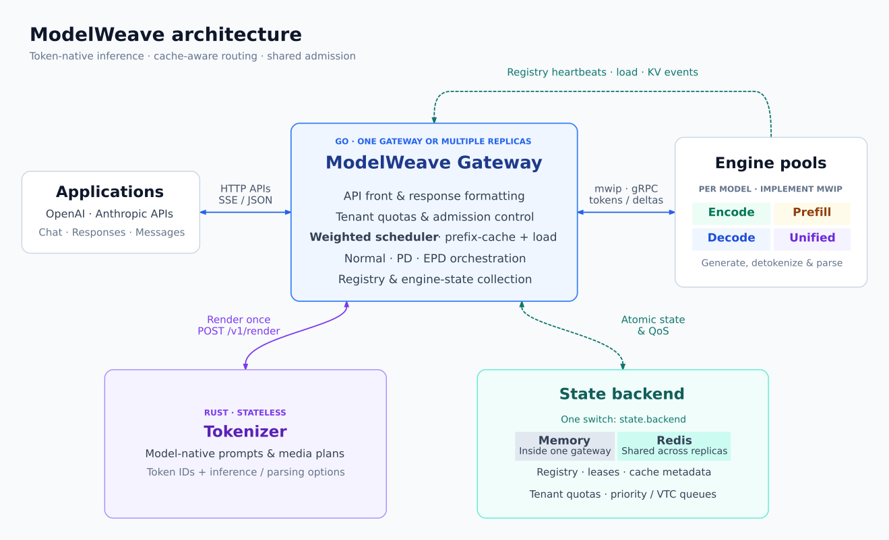

# Architecture

ModelWeave separates model-specific rendering from cluster scheduling and
engine execution. The gateway runs standalone with memory or as replicas
sharing Redis, including tenant quotas and admission queues.

[Editable Graphviz source and PNG export](../assets/diagrams/README.md).

| Component | Language | Responsibility |
|---|---|---|
| `modelweave-gateway` | Go | API front, tenant QoS, admission, cache/load scheduling, normal/PD/EPD orchestration, Registry, response formatting and telemetry |
| `modelweave-tokenizer` | Rust | Stateless API-to-token conversion, model-native prompts, media planning and generation/parsing options |
| Engine instances | Any | One model/role each; implement [mwip](mwip.md), execute inference, detokenize and parse output |
| State backend | Memory / Redis | Registry, health, reservations, cache metadata, tenant quotas and admission queues |

The tokenizer is called once per request and is not in the output path.
Engines always stream parsed events to the gateway; the gateway formats them
for the client's streaming or non-streaming API. Only metadata is shared
through Redis—never model weights, KV tensors or HTTP request bodies.

## Request lifecycle

1. **Front** (`internal/gateway/api.go`). Read the body, authenticate the API
   key to a tenant, resolve the served model, pick the session key
   (`X-Session-Id`, `prompt_cache_key`, `user`, `metadata.user_id`).
2. **Render.** One unary `POST /v1/render` to any tokenizer replica with the
   request verbatim. The answer is the intermediate state: the token list
   (every media position holding its pad value), the media items with their
   plans and placements, and the conversation, inference and parsing options
   (protocol §1). Invalid requests come back already shaped as the protocol's
   error body and are returned unchanged.
3. **Prefix hashes.** The token list is hashed as is into chained 64-token
   block hashes (`internal/kvindex`, protocol §4.3).
4. **Tenant QoS.** RPM / TPM token buckets and a concurrency cap per tenant
   (`internal/qos/limiter.go`). TPM is charged up front with prompt + reserved
   output and reconciled with the real usage at the end. Violations return
   **429 + Retry-After**.

   The backend is selected with the same `state.backend` as the registry:
   process-local memory, or global Redis quotas across gateway replicas.
5. **Overload shedding.** An overload controller per model maps pool
   utilization (KV usage, prefill queue, admission-queue fill) to levels
   L0–L4 with hysteresis; a priority matrix admits, drops probabilistically or
   rejects (**503 + Retry-After**). Requests whose prefix is mostly cached are
   exempt from drops (they are cheap).
6. **Encode (EPD).** If the prompt has media and the model has encoders,
   every item is encoded on an E instance (`Engine.Encode`, parallel,
   retried on other encoders), which builds content-addressed artifacts
   (cached; one packed tensor per item). No P/D capacity is held meanwhile.
7. **Plan + admission queue** (`internal/orchestrator/plan.go`). The planner
   picks the execution mode and reserves workers. When no worker has capacity
   the request waits in the model's admission queue (strict priority classes,
   VTC fair sharing between tenants, backfill, shedding of lower priorities,
    deadline → 503).

   In Redis mode this is a single per-model priority/VTC queue, not a queue
   per replica. Even the initial fast path goes through its fenced turn;
   canceled/stale turns cannot reserve worker capacity. Request bodies stay
   on their ingress gateway, which executes its callback when selected.
8. **Execute** (`internal/orchestrator/execute.go`). Run the plan. The engine
   client (`internal/engine`) turns each stage into an mwip `Generate` call
   and reads its stream as events (accepted, prefill done, delta, finish,
   error). Deltas go
   through the formatter (`internal/format`) straight to the client: SSE
   chunks for streaming clients, one JSON body at the end for the others.
9. **Finish.** Release reservations, reconcile TPM, record the session's decode
   worker, emit metrics and one structured access-log line.

## Engines and instances

Engines integrate through **mwip** only ([mwip.md](mwip.md), protocol §2):
an instance serves the gRPC `modelweave.mwip.v1.Engine` service at its
`target`, receives the intermediate state with the call's `disagg`, and
streams parsed output. There are no adapters for other engine APIs; an
engine built on another serving framework serves the Engine service in
front of it.

The gateway serves many models; each model has its own instances, one model
in one role each. The registry (`internal/registry`) indexes them by model
and role, and every scheduling pass asks for the candidates of one model and
role: unified and normal-capable decode instances for normal requests,
prefill and decode instances for PD, encode instances for the E stage.

### Registration and lifecycle

Instances register through the **mwip Registry**, a gRPC service the
gateway serves on `server.grpc_listen` (protocol §4.1):

* a `Heartbeat` describes one instance (id, model, role, target, capacity
  hints) with its `EngineState`, KV events and draining flag; an invalid one
  is rejected with the reason (`INVALID_ARGUMENT`, `NOT_FOUND`);
* an instance whose heartbeats stop expires after `discovery.heartbeat_ttl`
  (a sweep every second); `Deregister` removes it at once; its next
  heartbeat registers it again;
* `draining` in its heartbeats, or an operator's
  `POST /admin/workers/{id}/drain`, stops new requests (the two are
  independent: heartbeats do not undo an operator's drain);
* removing an instance forgets its prefix-cache index entries and session
  affinities; `modelweave_instance_removals_total` counts removals by model,
  role and reason (`deregistered`, `expired`).

Static instances (`discovery.workers`) are configured with the same fields;
they never expire, and `engine_state.poll` gets their load with `GetState`.

State lives in the configured backend: single-process `state.backend: memory`
(default), or a shared Redis namespace. In Redis mode engines can heartbeat
to any replica: every gateway sees the same registrations, engine reports,
drain flags, health and reservations. Prefix indexes, sessions and embedding
artifact metadata, tenant quotas and admission queues are shared too.
See [state-and-scheduling.md](state-and-scheduling.md) for configuration,
atomicity, leases, expiry, failure behaviour and a two-replica example.

## Execution modes

| Mode | Workers | Chosen when |
|---|---|---|
| `normal` | one worker does prefill and decode: a unified worker, or a decode worker registered with `normal: true` | only unified workers serve the model, `mode: normal`, or in `auto`: the decode worker caches most of the prompt (`normal.min_cache_ratio`), the uncached part is short (`normal.max_uncached_tokens`), or the session is pinned to it |
| `pd` | P + D | the uncached part of the prompt is long, or `mode: pd` |
| `epd_*` | E, then either of the above (metric label) | the prompt contains media and the gateway runs the encode stage |

`normal` runs a request without PD split. In `mode: auto` the decision is per
request (`planAuto`):

1. session affinity: a follow-up turn runs normal on the decode worker that
   served the session (it holds the conversation's KV);
2. otherwise the decode worker is chosen cache-aware among workers that run
   normal requests, and the request runs normal if that worker would compute
   at most `max_uncached_tokens` tokens or holds at least `min_cache_ratio`
   of the prompt;
3. otherwise the same decode worker is kept and a prefill worker is chosen
   cache-aware for a `pd` run.

### PD handshakes

The orchestrator implements three rendezvous styles (protocol §2.3), selected
per model with `pd.handshake` (default push), in the calls' `disagg`:

* **bootstrap**: P and D are sent concurrently with a shared room; D fetches
  KV from P's bootstrap server (`disagg.prefill.bootstrap_addr`).
* **pull**: P runs first and ends with `prefill_done` carrying a
  `kv_handle`, which D uses to pull the KV.
* **push** (Mooncake-style): D registers and acknowledges with its KV receiver
  and the length of the prefix it already caches; only then is P sent, and P
  pushes the missing KV to D.

In all three, D's first token decides success: once D streams, P's completion
no longer matters. A P failure before D's first token aborts D and re-runs the
pair (`retry.whole_retries`).

### Retries, fallback and deadlines

* One **absolute first-token deadline** per request
  (`server.first_token_timeout`) bounds every stage and retry; each stage gets
  the remaining budget as `timeout_ms`.
* Before the first token reaches the client:
  * a failed decode / normal / unified attempt is retried on another worker
    (`retry.stage_attempts`);
  * a failed **normal** attempt on a decode worker falls back to **pd** once
    (not charged to the retry budget), e.g. on `normal_rejected` or capacity
    errors (`normal.fallback_to_pd`);
  * a missing embedding artifact (`artifact_unavailable`) triggers one rebuild
    through E.
* After the first token, errors end the stream (an SSE error event); output is
  never replayed.
* Each attempt has its own id, used as the engine request id and as the
  pairing token of P and D.
* Client disconnects and timeouts abort the engines (the call is canceled,
  plus a best-effort `Engine.Abort`). Stop strings are the engine's job: it
  stops itself.

### Reservations

The gateway keeps an optimistic ledger per worker in its state backend
(`internal/registry/worker.go`): local in memory mode, shared across all live
gateway replicas in Redis mode:

* decode / unified / normal: KV tokens = prompt + reserved output
  (`min(max_tokens, reservation.output_tokens)`: engines grow longer outputs
  themselves), rounded to blocks;
* prefill / normal: uncached prompt tokens, optionally attention-weighted
  `u·(1+β(cached+u/2))` (`reservation.uncached_beta`), released when prefill
  completes.

Engine-reported usage is the truth: the effective usage of a worker is
`max(live reservations, reported usage + reservations made since the report)`.
The final capacity check and reservation are atomic in the backend, including
across gateway replicas in Redis mode. Reservations are optimistic: workers
still do the hard check and answer
`capacity_exhausted`, which the gateway treats as "retry elsewhere".

## Scheduling

`internal/scheduler` runs one pass per stage:

1. snapshot the candidates of the model and role;
2. filter: healthy (passive health ejects workers after consecutive transport
   errors or 5xx), not draining, able to run normal requests when required,
   capacity (KV, running requests, prefill queue);
3. prefix-cache lookup through the `kvindex.Index` adapter;
4. load per candidate (queued prefill tokens for P, running requests and KV
   utilization for D);
5. the registered policy picks; the backend atomically checks the snapshot's
   admission revision/capacity bounds and reserves, retrying on contention.

Policies (per role, `routing.<role>.policy`):

| Policy | Behaviour |
|---|---|
| `weighted` (default) | sum of registered scorer outputs times their weights: `prefix-cache` (cached ratio) and `load` (`1 − norm_load`), default weights 1:1; optional `affinity` and custom plugins. Configure `routing.<role>.scorers`. |
| `prefix-cache`, `load` | a single built-in scorer (encode defaults to `load`) |
| `cache_aware` | Legacy SGLang-router style: when load is balanced, the longest cached prefix wins if it covers `cache_threshold`; when imbalanced (`balance_abs_threshold`, `balance_rel_threshold`), the least loaded worker wins. |
| `session_affinity` | rendezvous hashing of the session key with bounded load; falls back to another policy for keyless requests |
| `least_load`, `power_of_two`, `round_robin`, `random` | classic load balancing |

All policies are registered factories; scoring plugins implement `Scorer`
and register with `RegisterScorer`, whole algorithms with `RegisterPolicy`.
Weights and unknown/duplicate plugin names are validated at startup. The
old weighted fields remain supported as aliases for scorer terms. Details
and a plugin example: [state-and-scheduling.md](state-and-scheduling.md).

### Cache-awareness adapters (`kv_index.type`)

| Type | Source of truth |
|---|---|
| `approx` | learned from routing decisions, bounded per worker by its KV capacity, with TTL |
| `events` | engine KV events (`stored` / `removed` / `cleared`) from Registry heartbeats or `PublishKVEvents`; short optimistic entries bridge the gap until the event arrives |
| `remote` | an external KV metadata service (`POST /v1/prefix/match`), falling back to `approx` on error |
| `none` | cache-blind |

Since media positions hold pad values derived from the media digest, the same
image or video frame yields the same blocks in every request: prefix caching
covers multimodal prompts without extra steps.

### Engine state

* **push:** Registry heartbeats carry `EngineState` (running/waiting
  requests, KV used/capacity, prefill queue, throughput).
* **pull:** `engine_state.poll` asks every instance with `Engine.GetState`,
  so static instances, which send no heartbeats, still inform the scheduler.
  Polls update the load only: registration lives on heartbeats.

Redis-mode replicas coordinate poll leases, and a slow poll cannot overwrite
a newer heartbeat/state mutation.

State older than `engine_state.stale_after` is ignored; the gateway's own
reservations always apply.

## Tokenizer internals

The tokenizer is a model registry (`tokenizer/src/model.rs`): every
`[[models]]` entry of its TOML file is loaded at startup — the model's
Hugging Face files and its family — and a render picks one by name or alias.
Two renderers produce the same intermediate state:

* **DeepSeek V4 / V4.1** (`deepseek.rs`) wraps deepseek-recipe: its protocol
  conversion (`ProtocolRequest::convert`), `DeepseekV41Encoding` /
  `DeepseekV4Encoding::render_conversation` and `PromptTokenizer::encode_ids`
  (special tokens only from the encoding, never from user text);
* **chat-template models** (`hf.rs`: Qwen3, Qwen3-VL, any Hugging Face chat
  template):
  * `chat.rs` converts Chat Completions, Responses and Messages requests
    into OpenAI-style messages, tools and sampling options the way vLLM and
    SGLang prepare requests for chat templates (developer → system, Anthropic
    tool results → tool messages, Responses function calls → assistant tool
    calls, tool-call arguments as objects, reasoning as
    `reasoning_content`, named tool choices narrowed to their tool);
  * `template.rs` renders the model's Jinja chat template with transformers'
    semantics (`trim_blocks`, `lstrip_blocks`, Python string methods, the
    `tojson` filter of `json.dumps`, `raise_exception`, `strftime_now`,
    Python spellings of printed values) and detects the template's content
    format (plain strings or typed parts) like vLLM;
  * every string of the request is escaped before rendering, so the special
    (control) tokens of the rendered prompt — `<|im_start|>`,
    `<|image_pad|>`, ... — are exactly those the template wrote; the text
    between them is tokenized with special tokens disabled, so a spelled
    control token stays text. Non-special added tokens (`<think>`,
    `<tool_call>`) are parsed as Hugging Face tokenizers parse them;
  * the thinking switch (`enable_thinking`), parsers (`qwen3`, `hermes`),
    stop tokens and sampling defaults come from the family and
    `generation_config.json`.

Media (`media.rs`, `vision.rs`) are shared: content blocks are extracted
(with their `metadata`, `pixel_control_options`, `frame_extract_options`) and
replaced by numbered placeholders before conversion; digests come from the
caller or the inline bytes; every item is planned by the model's vision spec:

* DeepSeek V4.1: recipe's `ImageTokenSpec` (14 px patches, 3× downsample,
  `n_h·(n_w+1)+2` tokens); videos sampled with qwen-vl-utils' `smart_nframes`,
  every kept frame a `"{t:.1} seconds"` text and its pad region;
* Qwen3-VL: Qwen2-VL `smart_resize` within the processor's pixel range
  (`(h/32)·(w/32)` tokens); videos sampled like the Qwen3-VL video processor
  (`fps` 2, 4–768 frames, per-frame pixel cap of qwen-vl-utils), two frames
  per temporal patch, every patch `"<{t:.1} seconds>"` + `<|vision_start|>`
  + its pad region + `<|vision_end|>`, as vLLM expands Qwen3-VL videos;
* the long-side limits (`detail: low`, `max_long_side`), `max_total_pixels`
  and source limits apply to every model.

Each rendered placeholder is replaced by its planned pad ranges. The execution
contract carries the frozen processor/resize/exact-frame plan, a content+plan
fingerprint and explicit prompt-offset ↔ packed-tensor-row mappings. Encoder
RPCs accept one item and return one embedding location; P/D never re-plan from
the client's original controls. See [multimodal.md](multimodal.md).
`max_tokens` is resolved against the context window.

Golden tests compare the token IDs of the chat-template renderer with
transformers' `apply_chat_template` and the reference tokenizer
(`tokenizer/testdata`). The service is stateless: rendering runs on a
blocking thread pool, and any replica serves any request (HTTP/1.1 and h2c on
one port).

## Gateway output (`internal/format`)

The formatter consumes the engine's parsed deltas and writes the client's
protocol (protocol §3): Chat Completions chunks with `reasoning_content` and
streamed `tool_calls`; Responses items and events (reasoning, message,
function calls); Anthropic content blocks (thinking, text, tool_use). The
same code builds the non-streaming body by aggregation, so stream and JSON
answers never diverge. It normalizes finish reasons (a stop after tool calls
is `tool_calls` / `tool_use`, a matched stop string is Anthropic's
`stop_sequence`), fills usage from the engine's usage (cached and reasoning
tokens), and ends broken streams with the protocol's error event.

## Package map

| Path | Content |
|---|---|
| `proto/modelweave/mwip/v1` | **mwip**, the engine protocol: the intermediate state, the Engine and Registry services ([mwip.md](mwip.md)) |
| `api/mwip/v1` | Go code generated from the proto (`make proto`) |
| `cmd/modelweave-gateway` | gateway binary (`-config`) |
| `cmd/modelweave-mockengine` | mock engine binary (one instance) |
| `internal/gateway` | HTTP handlers, request lifecycle, the mwip Registry service, admin API, metrics collectors |
| `internal/format` | client response formatting (Chat Completions, Responses, Messages; SSE or JSON) |
| `internal/orchestrator` | planning, execution, PD handshakes, encode stage, artifact cache, session map |
| `internal/scheduler` | scheduling passes and policies |
| `internal/kvindex` | block hashing, approximate / event / remote prefix indexes |
| `internal/registry` | instances by model and role, heartbeat expiry, draining, engine state, reservations, passive health |
| `internal/redisstate` | shared Redis instance state, atomic reservations, owner/poll leases, recovery of failed releases |
| `internal/enginestate` | the `Engine.GetState` poller |
| `internal/qos` | memory/Redis QoS backends: token buckets, tenant concurrency leases, priority/VTC admission queue, overload controller |
| `internal/tokenizer` | tokenizer client (unary render, failover between replicas) |
| `internal/engine` | the mwip client over gRPC (one connection per target): `Generate` (always streaming), `Encode`, `Abort`, `GetState`; error classification |
| `internal/mwip` | the intermediate state and engine events in memory, and their conversion to and from the mwip proto messages |
| `internal/mockengine` | simulated engine, one instance per process: the mwip Engine service, the registration lifecycle (heartbeats, draining, deregistration, KV resync) with test controls; generates and parses the markup of its model (DeepSeek DSML, Qwen `<think>` and hermes tool calls) |
| `internal/obs` | logging and Prometheus metrics |
| `tokenizer/` | Rust tokenizer service: model registry, DeepSeek and chat-template renderers, protocol conversion, media planning |
| `examples/python-engine` | a minimal Python engine implementing mwip from the proto |
| `deploy/compose` | local DeepSeek V4.1 / Qwen3 / Qwen3-VL stack with mock engines, Prometheus, e2e runner |
| `test/e2e` | end-to-end tests |
